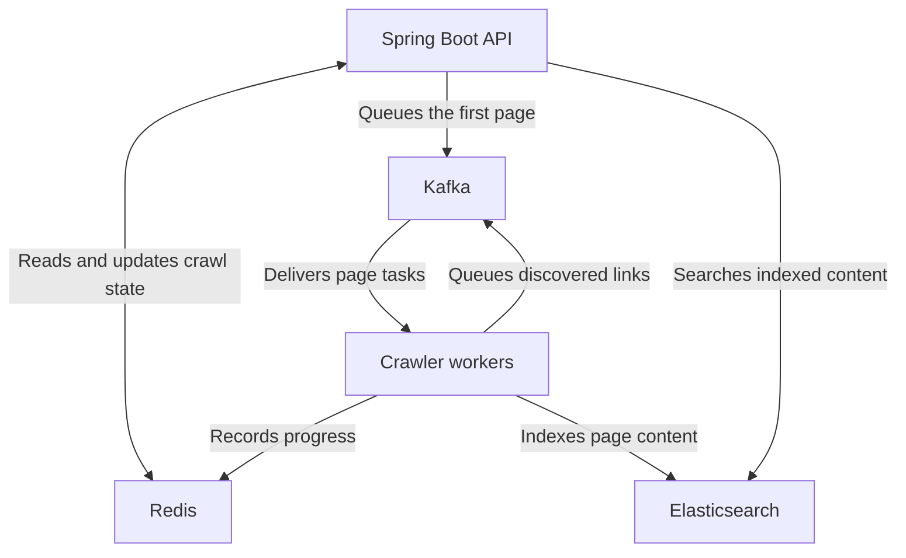
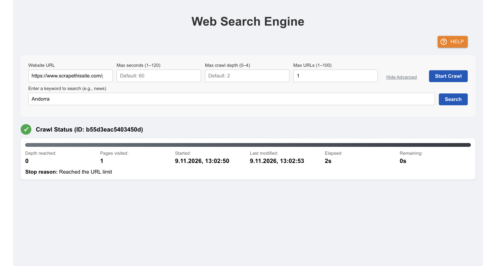
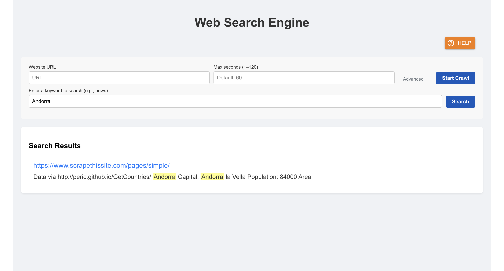

# Distributed Web Search Engine — Backend

A Java 21 and Spring Boot 4 API that crawls public web pages and makes their content searchable. Kafka distributes page tasks, Redis coordinates crawl state, and Elasticsearch indexes page content and returns highlighted search results.

[Live demo](https://esearchengine.vercel.app/) · [Frontend repository](https://github.com/elad9219/searchengine-frontend)

## Architecture



- Starting a crawl returns an ID that clients can use to read progress or request a graceful stop.
- Workers fetch public HTTP or HTTPS pages, extract text, and follow eligible links within the configured time, depth, and URL limits.
- The demo limits how often crawls can start. The fetcher checks destinations, including redirect targets, and rejects restricted network addresses.

## Run locally

You need JDK 21, Maven, and Docker with Compose. From the backend repository root, start the dependencies.

```bash
docker compose -f compose.local.yml up -d
docker compose -f compose.local.yml ps -a
```

Once Kafka, Redis, and Elasticsearch are healthy and `kafka-init` has exited successfully, start the API.

```bash
bash scripts/run-local.sh
```

The script loads [`dev/application-local.properties`](dev/application-local.properties) and binds the API to `127.0.0.1:8080`. The local stack uses its own Docker volumes and requires no hosted credentials.

| Service | Local address |
| --- | --- |
| Backend API | `http://127.0.0.1:8080` |
| Kafka | `127.0.0.1:19092` |
| Redis | `127.0.0.1:16379` |
| Elasticsearch | `http://127.0.0.1:19200` |

## API

| Method | Path | Purpose |
| --- | --- | --- |
| `POST` | `/api/crawl` | Start a crawl and return its ID |
| `GET` | `/api/crawl/{crawlId}` | Read crawl progress and status |
| `POST` | `/api/crawl/{crawlId}/stop` | Request a graceful stop |
| `GET` | `/api/search?query=Andorra` | Search indexed pages |
| `GET` | `/actuator/health` | Read application health |

With the API running locally, open [Swagger UI](http://127.0.0.1:8080/swagger-ui/index.html) or read the [OpenAPI JSON](http://127.0.0.1:8080/v3/api-docs).

### Run a one-page crawl

```bash
curl -fsS -X POST http://127.0.0.1:8080/api/crawl \
  -H 'Content-Type: application/json' \
  -d '{"url":"https://www.scrapethissite.com/pages/simple/","maxSeconds":30,"maxDistance":0,"maxUrls":1}'
```

Use the returned ID with the crawl status endpoint. After the crawl finishes and Elasticsearch refreshes the index, search for `Andorra`.

```bash
curl -fsS 'http://127.0.0.1:8080/api/search?query=Andorra'
```

## What the demo shows

These screenshots show the crawl status and search responses as rendered by the frontend.

### Crawl status



### Search results



## Tests and packaging

```bash
mvn verify
```

The default suite covers the API contract, crawl logic, page-fetch restrictions, Kafka publishing, and Elasticsearch response handling. To include the opt-in Redis state-store integration tests, start local Redis on port `16379` and run the following command.

```bash
SEARCHENGINE_REDIS_TEST=true mvn verify
```

The [Dockerfile](Dockerfile) packages the Maven-built JAR with a Java 21 runtime. For a hosted deployment, supply Kafka, Redis, and Elasticsearch settings through the environment. The [configuration template](src/main/resources/application.properties.example) lists the relevant properties.

## Contact

Elad Tennenboim · [Portfolio](https://eladt-portfolio.vercel.app/) · [GitHub](https://github.com/elad9219) · [LinkedIn](https://www.linkedin.com/in/elad-tennenboim/) · [Email](mailto:elad9219@gmail.com)